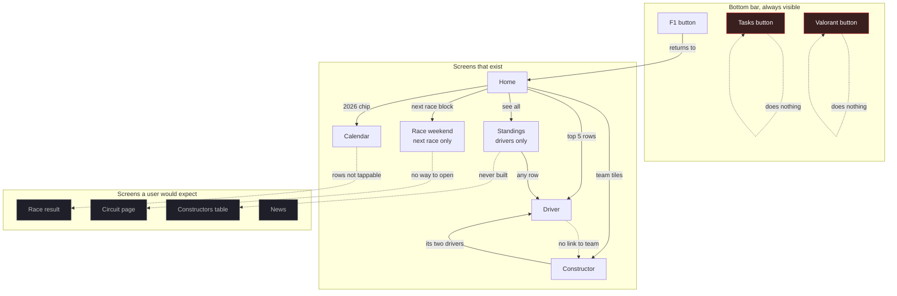
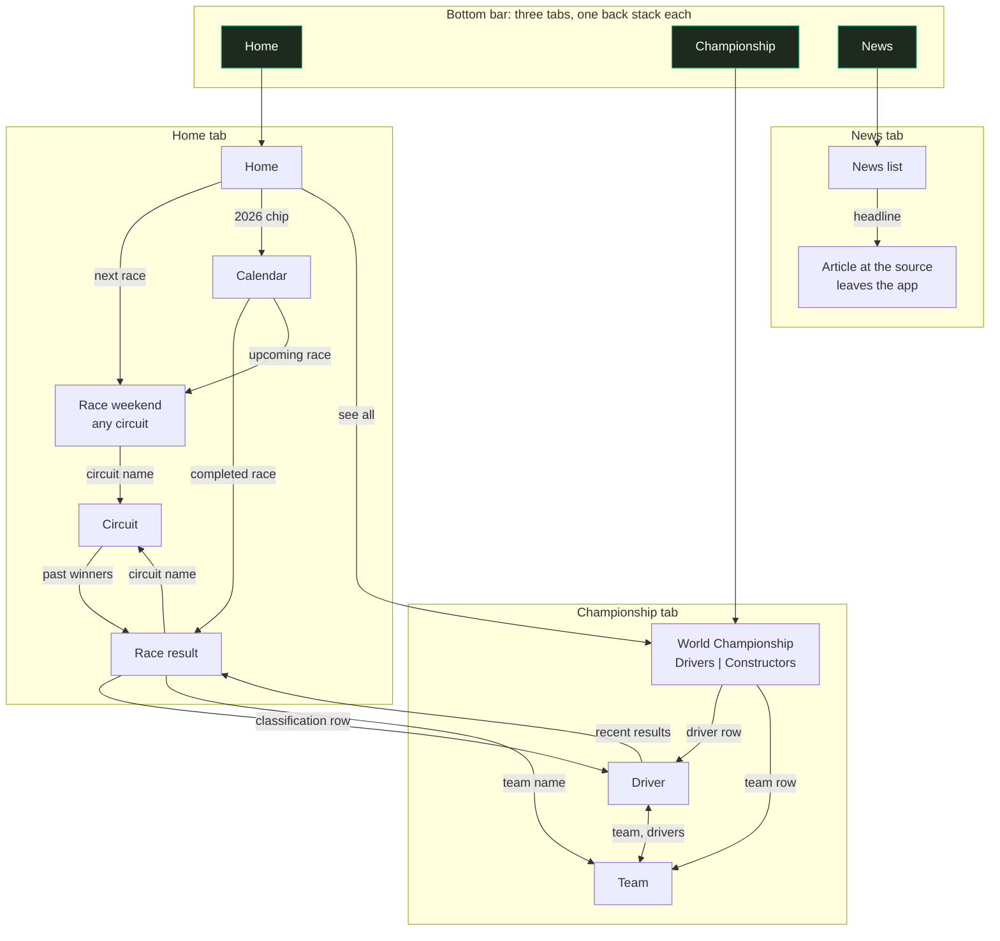

# f1-v2: Delta becomes an F1-only app with three tabs

Status: APPROVED 2026-11-14. In progress: S0 to S5 done (S5 uncommitted), S6 left (see Progress). Written 2026-11-14. Every number below was measured on that date unless marked "unverified".

## What changes

Tasks, Valorant, Twitch, dictation and sync are removed from the plan. The bottom bar becomes three tabs, each with its own back stack:

| Tab | Page | What it is |
|---|---|---|
| Home | Home (exists) | Next race, top 5, team tiles, calendar, race weekend |
| Championship | New | Toggle between the Drivers table and the Constructors table. Every row opens a driver or team page |
| News | New | Normalised headlines from free RSS feeds, tap to read at the source |

## Where the app is today

Read from the tap handlers in `ui/Screens.kt` and `MainActivity.kt`, not from memory. The floorplan (`floorplan/index.html`) shows the code structure; this shows the screen-to-screen paths it cannot see.

## Where it should be

## Gaps found

Ranked by how much they hurt. "Evidence" is what I ran or read.

| # | Gap | Evidence | Fix | Slice |
|---|---|---|---|---|
| 1 | Home and Weekend render blank once the season ends | `HomeScreen` does `next ?: return`, and the last race is Abu Dhabi on 2026-12-06, 22 days away. Season is also hardcoded `"2026"` | A season-complete state with a link to the final standings. Use Jolpica's `current` alias (returned season 2026) | S0 |
| 2 | The track image loads only for Spa | `CIRCUIT_KEYS` in `Repo.kt` holds one entry. The next race is Las Vegas (MultiViewer key 152). I probed all 23 circuits against `/circuits/{key}/2026`: 21 return an outline, Madring and Sepang have none | Pin the 21 keys (appendix A), show a quiet "outline unavailable" card for the other 2 | S1 |
| 3 | Eau Rouge is drawn on every track it is handed | `refreshCircuit` derives it from corners 2 to 5 for any circuit | Highlight only for Spa, otherwise none | S1 |
| 4 | Race Weekend is empty below the title for every circuit except Spa | Facts and sessions sit behind `facts != null`, which is Spa-only, and sessions are the hardcoded `SPA_SESSIONS` | Real session times already arrive in the calendar response (FirstPractice to Qualifying, Sprint when present, as UTC) but are not stored. Store them and show local time | S1 |
| 5 | Circuit facts exist for Spa only | Top speed and elevation are not in any free API I found. Length is derivable: polyline length is about 9,800 to 9,950 units per km, so a derived length is within 2% (checked on Spa, Monza, Silverstone, Suzuka, Monaco, Interlagos). Laps from the 305 km rule gives 44 for Spa, which matches (unverified for the other circuits) | Show derived length and laps, corner count as Turns. Drop top speed and elevation unless you supply data | S1 |
| 6 | No way to reach a circuit page, and none exists | No tap handler leads to a circuit. Weekend is the only track view and only for the next race | Circuit page with the 3D track, derived facts and past winners (`circuits/vegas/results/1` returns 3 rows). Entry points: weekend, race result, calendar row | S3 |
| 7 | Calendar rows are dead and there is no race result page | `CalendarRow` has no click. `JolpicaApi.results(season, round)` is declared and unused; round 20 returns 22 classified rows | Race result page. The full-season results the app already downloads cover every round, so no extra requests | S3 |
| 8 | There is no constructors table | Only Home tiles and a drivers-only Standings screen exist | The Championship page | S2 |
| 9 | Driver and team pages are dead ends with no history | Driver has no link to its team. Neither shows anything before 2026 | Cross links, career strip, season history, teammate head-to-head (details below) | S4 |
| 10 | Two of three bottom buttons do nothing | `NavIcon(... "Tasks") { }` and `"Valorant"` have empty handlers and `tab` is fixed at 2 | Replaced by the three real tabs | S0 |
| 11 | SECURITY.md says the network surface is two hosts | It names `api.jolpi.ca` and `media.formula1.com`. The app already calls MultiViewer too, and News adds about 8 feed hosts plus image CDNs. Pinning stays off, which SECURITY.md already explains and which is still the right call, since pinning that many hosts would brick the app on the first certificate rotation | Update the host list and the "what is in this project" table, keep the pinning decision | S6 |
| 13 | Small grey text fails contrast in light mode | `sec` #848484 is 3.43:1 on the light canvas and 3.74:1 on cards, `ter` #A7A7A7 is 2.20:1 and 2.41:1, against a 4.5:1 floor. Dark mode passes (5.45:1 and 8.47:1). Every meta label in the app uses these | Light-mode values for small text of about #6B6B6B (4.88:1) and #5A5A5A (6.32:1). Needs your decision because the greys were deliberately mode-invariant | S0 |
| 12 | Docs describe a different app | CLAUDE.md, README and the plan docs still list three tabs and call the code untested | Done in this pass | n/a |

## Page specs

### Championship

Header "World Championship" with a subtitle that reads "After round N of 23", or "Final standings" once the season is over. Under it a two-option segmented control, Drivers and Constructors, that remembers its choice across tab switches.

Drivers row: position, a team-colour tick (colour is data, never chrome), name, team, wins, points. Constructors row: position, team, wins, points. A season selector (the year as a chip, opening a list back to 1950) switches the whole page. Past seasons show final standings, fetched with one request per season and table and cached forever. When a season is over, the leader row carries a World Champion marker taken from the final standings, never computed from points.

Rows open `driver/{id}` and `constructor/{id}`, which already exist. The old Standings screen and its route are removed and Home's "see all" switches to this tab.

### Driver page, additions

Team name becomes a link. A career strip: titles, wins, podiums, poles. Season history: year, team, final position, points, wins. Teammate head-to-head for the current season (race and qualifying). Last five results, each opening its race result page.

### Team page, additions

A season points-by-round chart (sum of both drivers, derived from results already cached), history (titles, total wins, seasons with position and points), and both drivers as links.

### Race result

Grand Prix name, circuit (link), date, then the classification: position, driver (link), team (link), grid, time or status, points. Upcoming races open Race Weekend instead.

### Circuit

3D track, derived length, laps and turns, country, and past winners from Jolpica. Entry from Race Weekend, Race Result and a Calendar row.

## News

One shared model, every source mapped into it: `source, title, snippet, imageUrl?, publishedAt, url`. Fetched when the tab opens, cached 15 minutes in `feeds.db`, pull to refresh. No background fetching, which keeps the app's hard rule intact. Each feed fails independently and the tab shows what loaded.

What the feeds do differently, measured on 2026-11-14, and what normalisation has to absorb:

| Difference | Seen in | Rule |
|---|---|---|
| Image in four places: `media:thumbnail`, `enclosure`, several `media:content` widths, or the first `` of `content:encoded` | BBC (240px only), Sky and Autosport and Crash (enclosure), Guardian (140, 460, 700), The Race | Take the widest image offered. List rows use a small square thumbnail so the 240px BBC image never has to be upscaled |
| No image at all | RaceFans, ESPN, Formula1.com | A typographic row with no thumbnail, same height, so the list stays even |
| HTML in the snippet | Guardian (a bullet list), Autosport (` `) | Strip tags, decode entities, collapse whitespace, cut at 160 characters on a word boundary |
| Snippet repeats the title | BBC | Drop the snippet when it starts with the title |
| Title suffix | RaceFans appends " \| Formula 1" | Strip known suffixes per source |
| Date formats | Most RFC 822 with GMT or an offset, ESPN uses "EST", Crash has a trailing newline | Trim, parse leniently, fall back to feed order. Unit-test each |
| No dates and no images | Formula1.com official feed | Keep feed order and mark the date as unknown rather than inventing one |

Source set, all with real items and fresh dates on 2026-11-14 (ESPN added by the owner):

| Source | Feed | Items | Image |
|---|---|---|---|
| BBC Sport F1 | feeds.bbci.co.uk/sport/formula1/rss.xml | 71 | thumbnail |
| Sky Sports F1 | skysports.com/rss/12433 | 20 | yes |
| The Guardian F1 | theguardian.com/sport/formulaone/rss | 20 | yes |
| Autosport | autosport.com/rss/f1/news/ | 50 | yes |
| The Race | the-race.com/feed/ | 15 | yes |
| RaceFans | racefans.net/feed/ | 20 | none |
| ESPN | espn.com/espn/rss/f1/news | 24 | none |
| Formula1.com | formula1.com/content/fom-website/en/latest/all.xml | 10 | none, undated |

Left out on purpose: Motorsport.com (same publisher group as Autosport, 5 of Autosport's 50 titles recur in its feed, so it adds duplicates, not coverage), the FIA feed (covers karting and drifting, and its snippets are 5,000-character legal documents), PlanetF1 (404), F1Technical (403), Autoweek (returns HTML, not a feed), GPFans (10 items, low value). Crash.net also works and can be added later if more volume is wanted.

Stories that appear twice are collapsed by title similarity, keeping the one with an image. That only catches near-identical headlines (5 of Autosport's 50 matched Motorsport.com). It will not catch the same story worded differently: on 2026-11-12 BBC, Sky, ESPN and Formula1.com all ran the Racing Bulls 2027 line-up under different headlines. For V2 those show as separate rows. Grouping by the people and teams named is a later option. Tapping a headline opens the article in the browser with a plain intent, so there is no new dependency. The app shows the headline, a short snippet and a link, never the full text.

Not read: each publisher's RSS terms. This is a sideloaded single-user app, which is the low-risk case, but read them before the APK goes to anyone else.

## Data and request budget

Jolpica allows 200 requests an hour. Verified requirement: standings queries need a season, so one call cannot return a driver's whole career. The plan works around that.

| Data | How | Cost |
|---|---|---|
| Career wins, podiums, poles | `results/1`, `results/2`, `results/3`, `qualifying/1` with `limit=1`, read the total (Hamilton: 106, 60, 43, 120) | 4 requests per driver, cached forever for retired drivers, weekly for active ones |
| Season history and titles | `{year}/driverstandings` and `{year}/constructorstandings`, fetched lazily as pages need them | 1 request per season and table, shared by every driver, cached forever once a season is over |
| Race results | The full-season results already downloaded daily | 0 extra |
| Teammate qualifying head-to-head | `2026/qualifying` | 5 pages once a day, then cached |
| News | 8 feeds on tab open, 15 minute cache | Not Jolpica |

## Slices

Estimates in dev-days, rough. The ones marked logic are pure functions that unit tests can prove, which suits the `wf-ship` pipeline. The UI ones need an emulator and screenshots in both light and dark, which the workflows cannot do, so I would build those inline.

| Slice | Delivers | Gaps | Fit | Days |
|---|---|---|---|---|
| S0 | Three-tab shell with per-tab back stacks, dead buttons and icons removed, `current` season, season-complete state | 1, 10 | UI | 1 |
| S1 | 21 circuit keys, Spa-only gating, stored session times in local time, derived length, laps and turns, generalised Weekend | 2 to 5 | Logic plus UI | 1.5 |
| S2 | Championship page with both tables, season selector and the archive data layer | 8 | UI plus logic | 2 |
| S3 | Race result, tappable Calendar, Circuit page | 6, 7 | UI | 2 |
| S4 | Driver and team depth: links, career strip, season history, head-to-head | 9 | Logic plus UI | 3 |
| S5 | News: parser and normaliser tested against the saved feed samples, storage, tab, link-out | n/a | Logic first, then UI | 2.5 |
| S6 | SECURITY.md host list and News notes | 11 | Docs | 0.2 |

S0 first. S1 before S3. S5 can run any time after S0 and is the best first candidate for `wf-ship`, because the normaliser is a pure function with real inputs on disk.

## Decisions

Answered by the owner on 2026-11-14.

| # | Question | Answer | What it changes |
|---|---|---|---|
| 1 | News source set | Add ESPN | Eight feeds. ESPN has 24 items and no images, and its "EST" dates parsed |
| 2 | Top speed and elevation tiles | Drop | Feature W-04 is cut, the tiles are removed |
| 3 | News layout | Show five variants built with the three design skills | `news-variants.html` in this folder. A pick is still needed, my recommendation is Lead and wire |
| 4 | World Champion state | Use a reliable source | Taken from Jolpica's final standings once the last round is done. No clinch calculation. Correction to my earlier claim: the calendar does list sprint sessions (6 rounds in 2026), so a mid-season clinch could be computed if it is ever wanted |
| 5 | Season archive | Now | Pulled into S2 |
| 6 | Nav icons | Fetch | `ic_trophy.xml` and `ic_news.xml` are in `res/drawable` from Tabler (MIT), unused until S0 |
| 7 | Floorplan note in `CLAUDE.local.md` | Yes | Added |

Closed after the variants and the contrast finding:

- News layout: **Lead and wire** (recommended variant chosen).
- Gap 13, grey text contrast in light mode: **leave as it is.** `sec` and `ter` stay mode-invariant by owner decision. The News rows will therefore use the existing greys, not the darker values shown in the variants page.
- Spec approved to build on 2026-11-14.

## Progress

| Slice | State | Notes |
|---|---|---|
| S0 | Done 2026-11-14, uncommitted | Three tabs with separate back stacks, `current` season, season-complete state, 48dp bar targets, dead buttons removed. Closes gaps 1 and 10 |
| S1 | Done 2026-11-14, uncommitted | 21 circuit keys, Eau Rouge Spa-only, real session times in local time, derived length, real lap counts, Weekend for every circuit. Closes gaps 2 to 5 |
| S2 | Done 2026-11-14, uncommitted | Championship page: Drivers and Constructors toggle, season selector back to 1950, archive data layer, champion marker from final standings. Closes gap 8 |
| S3 | Done 2026-11-14, uncommitted | Race result page, tappable Calendar rows, Circuit page with past winners. Closes gaps 6 and 7 |
| S4 | Done 2026-11-14, uncommitted | Driver and team depth: team and driver links, career totals, season history, teammate head-to-head, recent results, team points by round. Closes gap 9 |
| S5 | Done 2026-11-14, uncommitted | News: eight press feeds, Lead and wire, Reddit tab with a subreddit picker |
| S6 | Mostly done | SECURITY.md News and Reddit notes are written |

S0 verification, on the Pixel 6 emulator, dark and light:

- Tab switching and per-tab stacks: Championship to a driver page, away to News and back restores that page. Home and Championship hold different driver pages at once (Antonelli vs Leclerc). Tapping the active tab pops to its root. System Back from a Championship detail goes to its root, and from the root to Home.
- Home "View all" switches to the Championship tab.
- Season complete: with the emulator clock set to 2026-12-07 the new build shows "Season complete, 23 rounds, finale in Abu Dhabi". The v1.1.2 tag built the same way and run at the same clock showed no text at all on Home, which confirms gap 1 by observation and not only from reading the code.
- Not exercised: the Weekend screen's new no-race guard (nothing on screen leads there once the season is over, so I could not reach it), and the first-launch loading state.
- Side fix: Home said "reminder on" under the race time, but no reminder feature exists. Removed.
- Known and expected at the time: the Las Vegas track outline and Weekend details were still missing, which S1 then fixed.

S1 verification and deviations:

- Las Vegas on the emulator now shows its track, 6.2 km (official 6.201), 50 laps, 17 turns, and five sessions in the phone's local time (FP1 00:30 UTC reads Fri 06:00 on the IST emulator, the race 04:00 UTC reads 09:30). Dark and light checked.
- **Laps changed from the plan.** The 305 km rule applied to the derived length matched the real lap count at only 16 of 21 circuits (Monaco, Marina Bay, Rodriguez, Interlagos and Yas Marina were each one lap off). Laps now come from Jolpica's past winners at the circuit, taking the largest of the last five so a red-flagged short race does not count. A circuit with no history (Madring) shows no laps tile.
- Length is derived from the outline at 9,930 units per km, one decimal, so it is approximate. Spa, Monza, Silverstone, Suzuka, Monaco and Interlagos were within 1.3% of official.
- Pure logic has unit tests (12): length against the real Spa outline (known answer 7.004 km), session ordering and sprint weekends, lap selection, time parsing. Each was run against a mutated build and the intended tests went red.
- **Bug found and fixed in the rate limiter.** After the emulator clock was moved forward and back, the limiter computed about -109,000 tokens and every request waited. Any backward clock correction on a real phone would have done the same. The limiter now treats a backward step as no time passing, with a regression test that fails without the fix.
- Home restored to match v1.1.2 exactly in the normal state, including the "reminder on" line, which S0 had removed without asking.
- Not exercised: Spa's Eau Rouge highlight still drawing (Spa is not the next race and nothing opens it), and the "no outline" card for Madring and Sepang. Both are covered only by reading the code.

S2 verification and deviations:

- On the emulator, dark and light: the Drivers and Constructors tables for 2026 ("After round 20 of 23"), the toggle surviving a trip through News, and the season selector across eras. Checked against known history: 1988 Senna 90 and McLaren 199, 1958 Vanwall 48 (the first constructors' title), 2025 Norris 423 and McLaren 833, 1950 Farina 30. 1957 correctly shows that there was no constructors' championship.
- Rows: a driver or team that also exists in the current season opens its page (Norris in the 2025 table opens his driver page). A retired one does nothing, because driver and team pages need the S4 history work first. Back returns to the same season.
- **A crash was avoided by measuring.** Historical rows for entrants who never scored come back with no `position` field (59 of 81 in 1950). The old model required it, so any such season would have failed to load. The model is tolerant now and the table shows ranked rows only (22 in 1950).
- 17 unit tests in total (7 new for the archive, using the real 1950 and 1988 payloads). Three mutations each failed the intended test.
- **Pull to refresh was dropped from S2.** This project's Material 3 (1.2.1 from the 2024.06 BOM) has no pull-to-refresh. It arrived in 1.3, so it needs a Compose BOM bump, which your rules make a separate reviewable change. Feature X-07 is deferred for that reason. The standings still refresh daily on their own.
- Old Standings screen and its route are removed. Home's "View all" now lands on the Championship tab.
- Not exercised: the champion marker for the *current* season once the final round is in (the data is only at round 20; the rule itself is unit tested), and the "Couldn't load" message with no network.

S3 verification and deviations:

- Emulator, dark and light, with screenshots 12 (race result) and 13 (circuit) added and 05 (weekend) re-shot. Calendar rows: a finished round opens its result, the next round opens Race Weekend, later rounds open the circuit. Result page and Race Weekend both link to the circuit. 20 unit tests pass (3 new, on the real round 20 results and the real Spa winners list).
- Checked against known facts: Qatar shows 5.4 km, 57 laps, 16 turns, 4 races held, most wins Verstappen 3. Spa shows 7.0 km, 44 laps, 59 races held, most wins Schumacher 6, and Eau Rouge still draws (the Spa-only highlight had not been exercised before). Madring has no outline, shows the plain message, and has one past race (2026).
- **Two measured surprises.** Jolpica gives retired and withdrawn drivers a numeric `position` (22 for a "W"), so the row label comes from `positionText` (R, D, W). It also gives lapped cars a time gap ("+27.120" for a car two laps down), which reads as a close finish, so lapped rows show "+2 Laps" instead. Mutating that rule made the intended test fail.
- **A defect found in S2 and fixed.** Leaving the Championship tab and coming back reset the list to the top. The cause is the first frame having no rows, so Compose clamps the restored scroll offset to a short card. The same cause made Back from a race result reset the Calendar. Both now keep position (confirmed by scrolling, leaving and returning, before and after).
- Deviations from the page spec: the team name on a result row does not link to the team (a second tap target inside a row; it comes with the S4 driver and team links). Past winners are not tappable, because only the current season's race results are stored. Past-race results for earlier years would need one request per race.
- Results are stored from the daily season download, so a race that finished today can take until the next daily refresh to appear. The page says so.
- Race Weekend gained a "›" and a tap on the circuit name. Its spacing is unchanged from v1.1.2 (checked against the old screenshot: name and date sit at the same pixel rows).
- Not exercised: a result page on a sprint weekend, and the Circuit page when the network is down.

S4 verification and deviations:

- Emulator, dark and light, screenshots 14 (driver page, lower half) and 15 (team page, lower half). Driver page gained: a Team link, Career (wins, podiums, poles, titles), Against your teammate, Recent results (each opens its race, Back returns to the same place) and Seasons. Team page gained: points by round, Career and Seasons.
- Checked against known history. Hamilton: 106 wins, 120 poles, 7 titles, with the champion marker on 2008, 2014, 2015, 2017, 2018, 2019 and 2020, and 2021 as P2 with 387.5 points. Ferrari: 251 wins. 31 unit tests pass (8 new). Reversing the finish comparison made the head-to-head test fail on the intended line.
- **Titles need the full history.** The only way to count titles is each season's final table, one request per season. The history is loaded on a tap ("Load 19 more seasons") so it never spends the Jolpica budget unasked, and the Titles tile appears once every past season is saved. Hamilton cost 19 requests, once, kept forever. A team with a long history (Ferrari, 68 seasons) says "one request each" on the button. The rate limiter paces them.
- **Poles are for drivers only.** Jolpica's qualifying results start in 1994, so Ferrari showed 126 poles against about 250 real ones. Teams show wins and podiums only. A driver whose career began before 1994 would be under-counted the same way, and none of the current drivers is one.
- **Head-to-head uses the starting slot, not qualifying.** It costs no requests, since it reads the race results already saved. Starting slot is after penalties, so the card says it stands in for qualifying. A retirement loses to a classified finish, and two retirements settle nothing.
- **Still open:** a retired driver in an old Championship table does not open a page, because the page is built from the current season's standings. That needs a separate lighter page and is not in this slice. The "Points by round" chart wraps two-digit round numbers on its x axis ("1 0"); it is shared with the driver page and was already like that.
- A scroll-restore defect appeared again on these pages (Back from a race reset the driver page to the top). They reserve a tall minimum height for 400 ms while their sections load.

S5 verification and deviations:

- Emulator, dark and light, screenshots 09 (Press) and 16 (Reddit). Live run: all eight feeds loaded, 167 stories, the lead is the freshest story with a picture. 48 unit tests pass (17 new: every saved real feed, Guardian widest picture, RaceFans suffix, BBC repeated snippet, ESPN "EST" date, hostile links, caps, an entity-bomb DOCTYPE, duplicate collapsing, and the Reddit feed). One test caught a real bug: escaped script blocks left their text behind.
- **Reddit, measured 2026-11-14.** The JSON and OAuth endpoints answer 403 without credentials. The Atom feed works. About nine requests in a minute drew a 429 on every subreddit, and the next response carried `x-ratelimit-remaining: 0, reset 57`. On the emulator, switching between the first two subreddits worked and the third within a minute got a 429, which the tab shows as "Reddit asked for a pause" while keeping the old copy. The feed has no scores, comment counts or reliable image, so rows are title, time and the opening of any text post. Decision: RSS plus link-out, no client, no API key. A real API key would add scores and thumbnails if this ever feels thin.
- Press rows are dense type with no thumbnails, as in the chosen Lead and wire variant. Only the lead has a picture.
- Pull to refresh is still deferred; a Refresh text button forces a fetch instead.
- The one new dependency is `kxml2`, test only: the same pull parser Android ships.
- Not exercised: a feed that fails with the network off, and scroll position after a tab switch (the same first-frame effect as the Calendar may apply).

## S7: polish (picked by the owner 2026-11-14, from `.scratch/f1-v2/polish-variants.html`)

| Block | Pick |
|---|---|
| Bottom bar | Sliding thumb, icons only (Cult UI Halo Segmented) |
| Toggles (Drivers/Constructors, Press/Reddit) | Spring thumb on a frosted track |
| Standings and news rows | Lit top edge plus press-in to 97% |
| Buttons | Solid red pill with arrow for the one primary action per page, secondary links stay text |
| Stat blocks | Count up once on arrival, 450 ms ease-out |
| Race reminder | Bell in the top bar beside the season chip, outline off and filled red on, ring wiggle, haptic, toast. The "Lights out" line stays plain text |
| Season picker | Bottom sheet with a year grid, drag to dismiss |
| Loading | Skeleton rows, then staggered fade-in on the first six rows |
| Audit | All included: collapsing headers, 48 dp touch targets, haptics, real pull-to-refresh (needs the Material 3 1.3 BOM bump as its own change first), chart label fix, empty and error states with a Try again pill, image fade-in, predictive back, one motion system, warmer light canvas #F8F8F5 |

Not picked: expandable rows, boxed mono-caps, label-expanding nav, direction-aware tabs, blur-in, texture and neutral pill buttons, the switch row and lead-time picker.

S7 verification and deviations:

- Built in one pass at the owner's request, after a separate Compose BOM bump (2024.09.03, Material 3 1.3.0) that was committed first. 48 unit tests pass. Checked on the emulator in dark and light, every screenshot re-shot.
- Done: sliding-thumb bottom bar, spring-thumb toggles, lit card edge and press-in on rows, red pill buttons for the one primary action (Load more seasons, Show all, Try again), count-up stats, bell in the Home top bar with a toast (the hero line is plain again, spacing back to v1.1.2), season bottom sheet with a year grid, skeleton rows, staggered first-six arrival, image fade-in, state messages with a Try again pill, chart labels on every second round, collapsing titles on Championship, News and Calendar, pull to refresh on Home, Championship and News, haptic ticks, predictive back transitions, 48 dp tap areas on the chips, bell and toggles, and the warmer light canvas.
- Measured: the bell toggles the real OS alarm (1 armed, 0 after off, 1 after on). Pull to refresh shows the indicator and ends without a crash. Setting the phone's animation scale to zero loads every screen with no crash.
- Not done or different from the board: the "View all" link on Home is still small text, because enlarging it would push the Drivers list down 18 dp on a screen you asked me not to change. Result, circuit, driver and team pages have no collapsing title (their titles are part of a hero). The first-six-rows arrival can replay if a list is scrolled far away and back. Haptics and the spring feel were not felt on a real phone; only the code paths ran.
- The previous "reminder on/off" text line is gone. Tapping the date line does nothing now.

## Not doing

Tasks, Valorant, Twitch, dictation, Syncthing, the CRDT engine, widgets, live timing, OpenF1 telemetry. Live timing and telemetry stay in the F1 section of the architecture doc as later options, not V2.

## Appendix A: circuit keys measured for the 2026 calendar

Ergast `circuitId` to MultiViewer key. Each returned an outline from `/circuits/{key}/2026`.

albert_park 10, shanghai 49, suzuka 46, miami 151, villeneuve 23, monaco 22, catalunya 15, red_bull_ring 19, silverstone 2, spa 7, hungaroring 4, zandvoort 55, monza 39, baku 144, marina_bay 61, americas 9, rodriguez 65, interlagos 14, vegas 152, losail 150, yas_marina 70.

No outline: madring, sepang.
