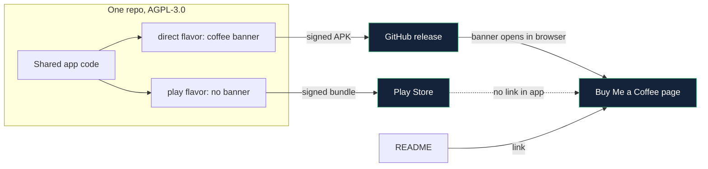

# Launch plan: open source, coffee page, Play Store, Reddit

Status: approved 2026-11-14. L1 and L2 are done and released as v1.3.1 (commit bb3a6b9). `supportUrl` is set to the owner's Buy Me a Coffee page. L0 items still with the owner: trademark search, email decision, keystore backup. Written after v1.3.0.

## Decisions already made

| Topic | Decision |
|---|---|
| F1 images (car, headshots) | Stay in every build, Play included. Takedown risk accepted. Kept behind `Net.car` and `Net.headshot` so one flag can swap to drawn art |
| Licence | AGPL-3.0 for the code. Name, icon and F1's images are not covered by it |
| Coffee page | Buy Me a Coffee (India payouts listed on its help page, 5% plus Stripe fees). Link lives in one setting so Ko-fi can replace it |
| Banner | GitHub build only. The Play build has no banner and no donate link |
| UPI | Not used |

## How it fits together

## Phases

**L0. Before anything is public**
- Search "Delta" in software classes at USPTO and EUIPO. If another software "Delta" is registered, rename before Play, not after.
- Git history audit: done 2026-11-14. No keystore, password or token was ever committed. Two things to fix: `keystore.properties.example` has a local path that includes the OS username, and all 20 commits carry the Gmail address. Rewriting history is destructive, so that is your call. The alternative is to switch to the GitHub noreply address for new commits only.
- Back up `~/f1-release.jks` somewhere off this Mac. Losing it means no updates. Play App Signing later makes the upload key replaceable.

**L1. Repo hygiene (small)**
- `LICENSE` (AGPL-3.0), a NOTICE listing third-party assets (Inter font, Tabler icons, F1's images and the data sources, none of which the licence grants), a README disclaimer: "Unofficial. Not affiliated with Formula 1 or any team."
- CONTRIBUTING note: outside code needs a contributor agreement before it can ship in the Play build, because AGPL contributions you do not own cannot be relicensed to Play's terms.
- Check every dependency's licence is compatible with AGPL (all Apache-2.0 or MIT on a first look; verify with the dependency report).

**L2. Two build flavors and the banner**
- Flavors `direct` and `play`. The banner exists only in `src/direct`, so the Play build cannot contain it by construction.
- The banner sits below the last Home row and is seen only by scrolling to the bottom. One line of text, one button, opens the link with a plain `https` intent. No network call from the app, so SECURITY.md gains one line and no permissions change.
- Coffee URL from one Gradle property.

**L3. Polish pass (system view)**
- Audit against `design-system.md` with the installed `impeccable`, `mobile-native`, `emil-design-eng` and `apple-design` skills.
- Add Accessibility Scanner findings, font-scale 130% and 200% checks, TalkBack labels, contrast in both themes, foldable and tablet widths.
- Add a few screenshot regression tests for the hero and standings rows so polish does not drift.
- Scope to be fixed after the audit lists what it finds, not before.

**L4. Media**
- Record real footage with `adb screenrecord` or scrcpy on the emulator, clean status bar (demo mode), both themes.
- Store assets: 2 to 8 phone screenshots, a 512 px icon, a 1024 x 500 feature graphic (confirm sizes in Play Console).
- Optional 15 second intro with `/brag`, which builds from website code, so it would be a stylised clip around the real footage.

**L5. Play Store**
- Developer account (one-time fee, confirm amount). Switch release to an Android App Bundle with Play App Signing.
- Data safety form: the app collects nothing, but its requests expose the phone's IP address to Jolpica, MultiViewer, F1's CDN and the news hosts. Say so.
- Closed test: 12 testers opted in for 14 days in a row, then apply for production. Recruit testers early. This is the longest wait.
- Listing carries the "unofficial" line. No F1 logo, no "Formula 1" in the app name.
- Kill switch: if F1 or Google objects, a flag swaps the F1 images for drawn cars and initials and ships as an update.

**L6. Reddit**
- Read each subreddit's rules first (r/formula1's self-promotion rule was not found). Reddit-wide norm is about 10% self-promotion.
- Post the story: lost a job, built it in free time, premium feel for a premium sport. State the limits plainly: Jolpica allows 200 requests an hour, Reddit about 1 a minute, no live timing, no background work by design. Say the infrastructure gets paid for if enough people use it and chip in.
- Drafted after the Play build is live. Can also recruit the 12 testers if you want it earlier.

## Risks

| Risk | Mitigation |
|---|---|
| F1 images draw a takedown | Kill switch, disclaimer, no F1 marks in the name or icon |
| Google rejects over F1 content | Same kill switch. An account strike is the worse case, so no banner in the Play build |
| "Delta" is taken | L0 search first |
| Jolpica volunteer-run, 200 per hour | Already cached and rate limited. Say so in the post |
| Keystore lost | Off-machine backup, Play App Signing |
