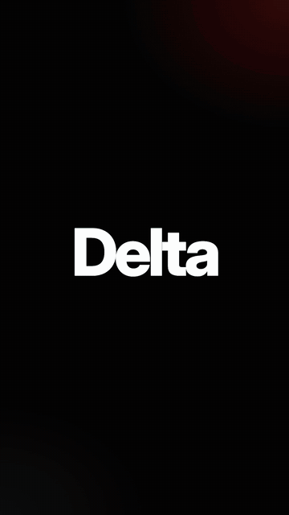
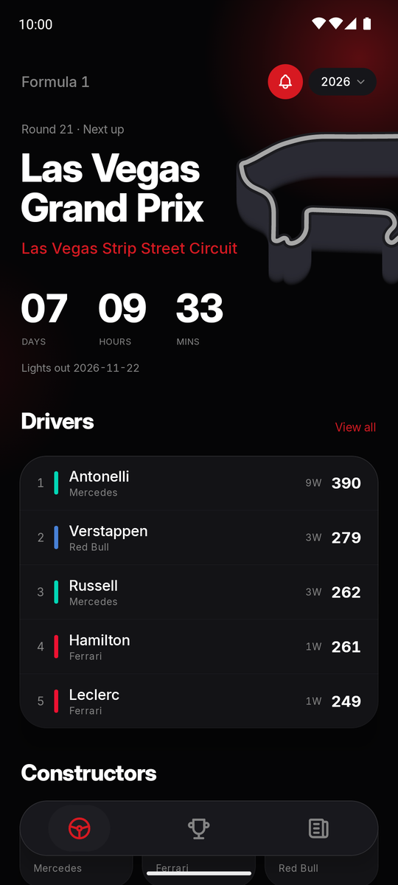
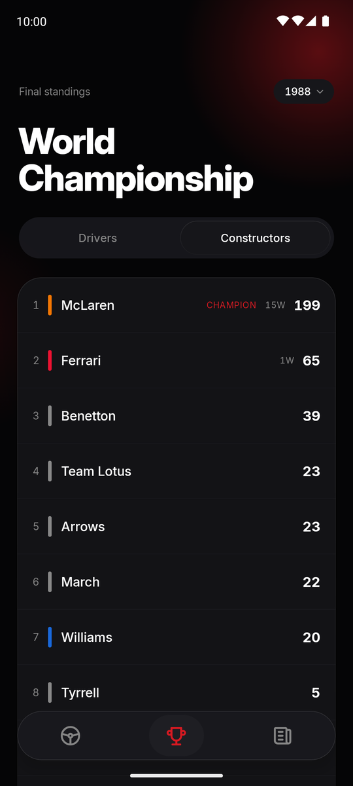
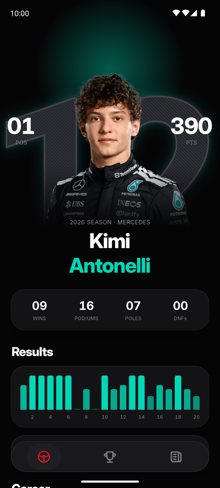
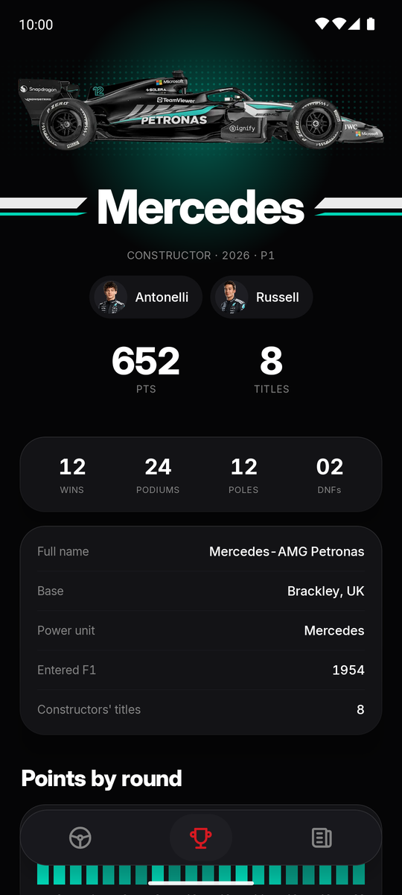
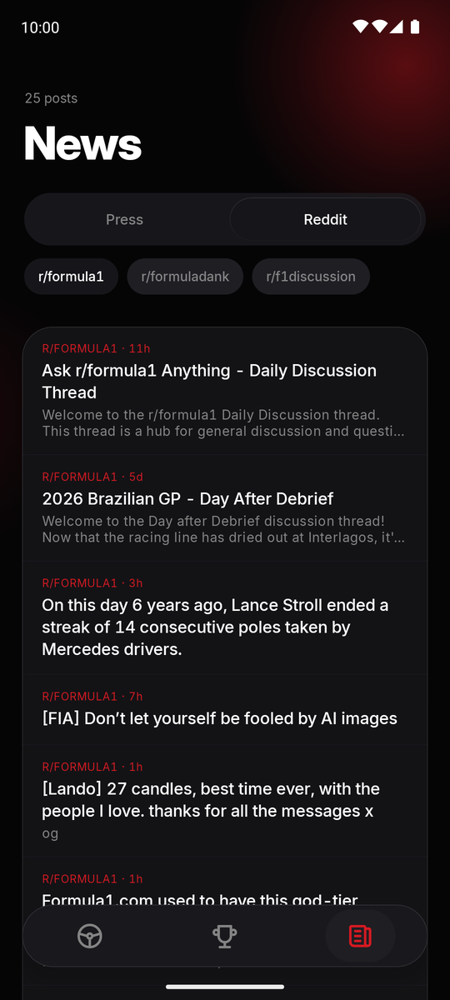
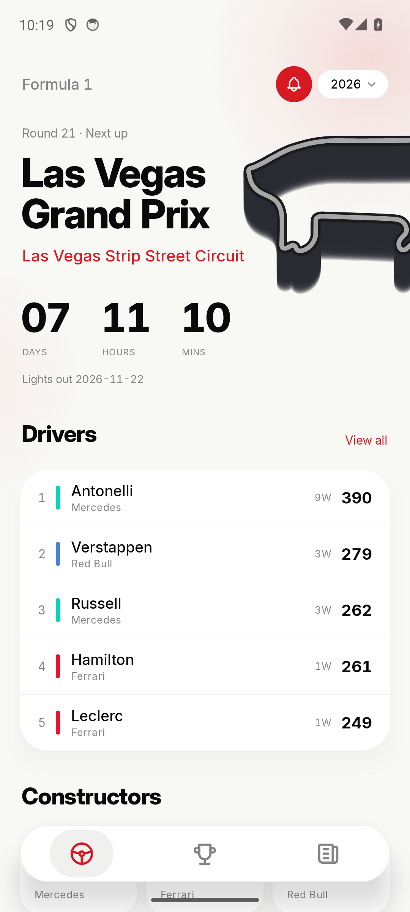
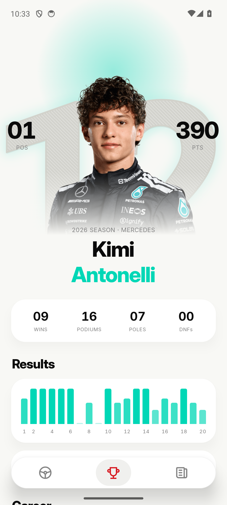
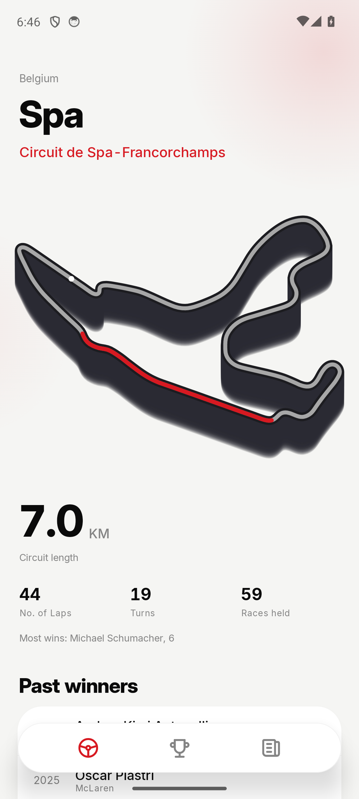
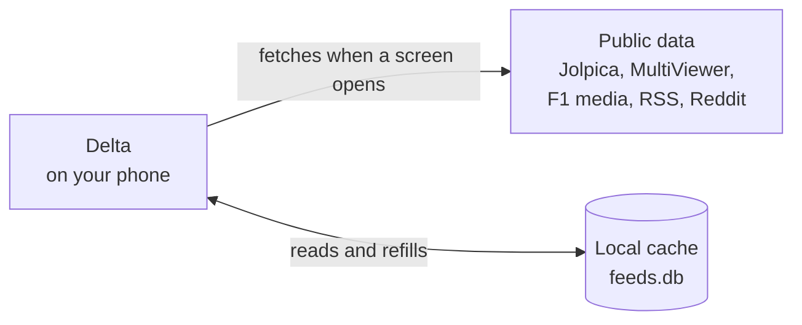

<div align="center">

# Delta

**A free, open-source Formula 1 tracker for Android.**

Every season since 1950, driver and team pages, 3D circuit maps, news and Reddit.<br>
No ads, no account, no server.

[](https://github.com/pokhriyal-anmol/delta/releases/latest)
[](https://github.com/pokhriyal-anmol/delta/actions/workflows/ci.yml)
[](LICENSE)


[](https://github.com/pokhriyal-anmol/delta/releases/latest)

<a href="docs/media/demo.mp4"></a>

</div>

> [!NOTE]
> Unofficial fan project. Not affiliated with Formula 1, Formula One Group, the FIA or any team.

## Screenshots

<p align="center">
  
  
  
  
  
  
</p>

<details>
<summary>Light theme and the full set</summary>

<p align="center">
  
  
  
</p>

Delta follows the phone's theme. All 36 screenshots are in [`screenshots/`](screenshots/README.md).

</details>

## Why Delta

- Nothing to sign in to, no ads and no tracking SDKs. Delta has no server of its own.
- It does nothing when it is closed: no polling, no background jobs, no foreground service.
- History goes back to 1950, and every past season shows its champion.
- It keeps working from a local cache when the network drops, and says so.
- The code is open under AGPL-3.0.

## Install

1. Open the [latest release](https://github.com/pokhriyal-anmol/delta/releases/latest) on your phone and download the `.apk`.
2. Open it and allow installs from your browser or file manager when Android asks.
3. To update, repeat with the newer release. Updates install over the old version.

Prefer automatic updates? Add Delta to [Obtainium](https://github.com/ImranR98/Obtainium), which watches this repository's releases and installs new versions for you:

[](https://apps.obtainium.imranr.dev/redirect?r=obtainium%3A%2F%2Fadd%2Fhttps%3A%2F%2Fgithub.com%2Fpokhriyal-anmol%2Fdelta)

Needs Android 8.0 or newer. Delta is not on Google Play or any other store, only because of the developer fee.

## What it does

- **Standings:** drivers and constructors for any season back to 1950, plus the full result of every finished race this season.
- **People and teams:** season stats, points by round, career totals and teammate head-to-head, with each team's real 2026 car.
- **Calendar and circuits:** session times in your local time, and a 3D map of 21 of this year's 23 circuits with length, laps, turns and every past winner.
- **News:** eight press feeds in a lead-and-wire layout, and a Reddit tab for r/formula1, r/formuladank and r/f1discussion.
- **Reminder:** one optional notification an hour before lights out.

## How it works

Delta asks free public services for data when you open a screen, keeps a disposable copy on the phone, and stops there.



| Source | Used for |
|---|---|
| [Jolpica](https://github.com/jolpica/jolpica-f1) | Calendar, standings and results back to 1950 |
| [MultiViewer](https://multiviewer.app) | Circuit geometry for the 3D maps |
| F1 media server | Driver headshots and car images, loaded and never stored |
| Press RSS feeds and Reddit | Headlines and the Reddit tab |

The design reasoning is in [docs/architecture.md](docs/architecture.md), and the threat model is in [SECURITY.md](SECURITY.md).

## Limits

- No live timing and no alerts for things that happen mid-session. That needs background work, which Delta does not do.
- Jolpica allows 200 requests an hour, so everything is cached and some data loads only when you open it.
- Reddit allows about one request a minute, so its tab shows no scores or comment counts.
- Race results exist for the current season only, and a retired driver in an old table does not open a page.
- Android only.

## Build from source

Needs JDK 17 and the Android SDK.

```bash
./gradlew assembleDirectDebug
adb install -r app/build/outputs/apk/direct/debug/app-direct-debug.apk
./gradlew testDirectDebugUnitTest testPlayDebugUnitTest
```

`direct` is the build published here and may show one support link at the bottom of Home. `play` is the same app without it. More in [CONTRIBUTING.md](CONTRIBUTING.md) and [docs/](docs/).

## Project

Delta is actively maintained by one person in their spare time, and the latest release is v1.4.0. Bug reports and focused fixes are welcome, see [CONTRIBUTING.md](CONTRIBUTING.md). Changes are in [CHANGELOG.md](CHANGELOG.md). If Delta earned a place on your phone, you can [buy me a coffee](https://buymeacoffee.com/anmolpokhriyal). A star helps too.

The code is [AGPL-3.0](LICENSE). The name, the icon and everything that belongs to Formula 1 are not covered, see [NOTICE](NOTICE). Thanks to Jolpica for the data, MultiViewer for the circuit geometry and [Inter](https://rsms.me/inter/) for the type.
