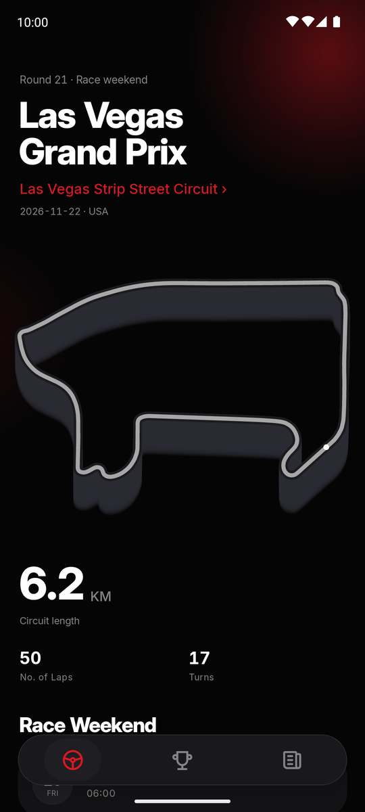
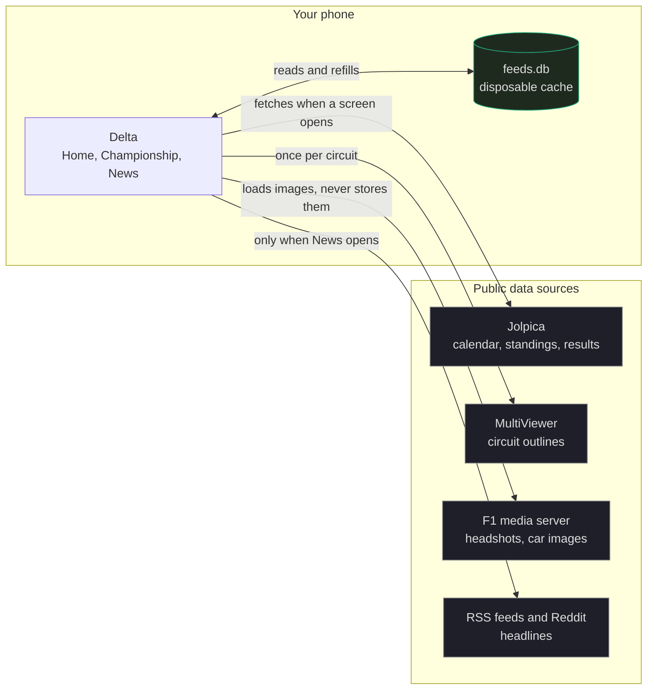

<div align="center">

# Delta

**A free, open-source Formula 1 tracker for Android.**

Standings back to 1950, driver and team pages, race results, 3D circuit maps and a news tab.
No ads, no account, no server, no background work.

[](https://github.com/pokhriyal-anmol/delta/releases/latest)
[](https://github.com/pokhriyal-anmol/delta/releases)
[](https://github.com/pokhriyal-anmol/delta/actions/workflows/ci.yml)
[](LICENSE)


[**Download the APK**](https://github.com/pokhriyal-anmol/delta/releases/latest) ·
[Screenshots](#screenshots) ·
[How it works](#how-it-works) ·
[Build from source](#build-from-source) ·
[Contributing](CONTRIBUTING.md)

<br>

<a href="docs/media/demo.mp4">
  
</a>

<sub>25 second tour, recorded on a Pixel 6 emulator. <a href="docs/media/demo.mp4">Watch the full-quality video.</a></sub>

</div>

> Unofficial fan project. Not affiliated with, endorsed by or connected to Formula 1, Formula One
> Group, the FIA or any team. See [NOTICE](NOTICE).

## Screenshots

<table>
  <tr>
    <td align="center"></td>
    <td align="center"></td>
    <td align="center"></td>
    <td align="center"></td>
    <td align="center"></td>
  </tr>
  <tr>
    <td align="center"><sub>Next race, live countdown</sub></td>
    <td align="center"><sub>Every season since 1950</sub></td>
    <td align="center"><sub>Driver pages</sub></td>
    <td align="center"><sub>Team pages</sub></td>
    <td align="center"><sub>3D circuit maps</sub></td>
  </tr>
</table>

Dark and light themes follow the phone. The full set of 36 screenshots, both themes, is in
[`screenshots/`](screenshots/README.md).

## Features

**Standings and history**
- Driver and constructor standings for any season back to 1950, with the champion marked
- A season picker that fetches a past season once and keeps it
- Race results for every finished round of the current season, with laps down and retirements

**People and teams**
- Driver pages: team-colour glow, headshot, season stats, points by round, career totals,
  teammate head-to-head, recent results and season history
- Team pages: the team's real 2026 car, both drivers, season stats, team facts and career totals

**Calendar and circuits**
- The full calendar with session times in your local time
- A 3D map of 21 of this year's 23 circuits, with derived length, laps, turns and the winner
  of every race held there

**News**
- Eight press feeds in a lead-and-wire layout, and a Reddit tab for r/formula1, r/formuladank
  and r/f1discussion
- Stories open in your browser or the Reddit app

**Everything else**
- One optional notification an hour before lights out
- Light and dark themes, predictive back, haptics, pull to refresh and reduced-motion support
- Works from a cache when the network is down: a failed refresh shows the old data, never a blank screen

## Install

1. Open the [latest release](https://github.com/pokhriyal-anmol/delta/releases/latest) on your phone and download the `.apk` file.
2. Open it. Android asks once to allow installs from your browser or file manager. Allow it, then install.
3. To update, repeat with the newer release. The app keeps nothing that is worth losing.

Requires Android 8.0 or newer. Releases are signed with a single key, so updates install over the
previous version.

Delta is not on Google Play or any other store. A developer fee is the only reason. If enough
people want it there, that will change.

## How it works

Delta has no server of its own. It asks free public services for data when you open it, keeps a
disposable copy on the phone, and does nothing at all when it is closed.



| Source | Used for | Limits |
|---|---|---|
| [Jolpica](https://github.com/jolpica/jolpica-f1) | Calendar, standings and results back to 1950 | 200 requests an hour, so everything is cached |
| [MultiViewer](https://multiviewer.app) | Circuit geometry for the 3D maps | Free, no key |
| F1 media server | Driver headshots and car images, loaded and never stored | Hotlinked, so a change on their side shows as a missing image |
| Press RSS feeds | Headlines | Fetched only when the News tab opens and the cache is over 15 minutes old |
| Reddit | The Reddit tab | About one request a minute, so it shows no scores or comment counts |

### Rules the app keeps

- **No background execution.** No polling, no periodic jobs, no foreground services. The one
  exception is a single alarm for a known future time: the race reminder.
- **No server, no account, no analytics, no ads.** Nothing to sync, nothing to lose.
- **Untrusted input stays untrusted.** Feed and API text is stripped to plain text, only `https`
  links open, and sizes are capped. See [SECURITY.md](SECURITY.md).

The reasoning behind these and the other design decisions is in [docs/architecture.md](docs/architecture.md).

### Known limits

- No live timing and no alerts for things that happen mid-session, because that needs background work
- Race results exist for the current season only
- A retired driver or team in an old championship table does not open a page
- Android only

## Build from source

Needs JDK 17 and the Android SDK (`ANDROID_HOME` set).

```bash
./gradlew assembleDirectDebug
adb install -r app/build/outputs/apk/direct/debug/app-direct-debug.apk
```

Run the unit tests for both flavors:

```bash
./gradlew testDirectDebugUnitTest testPlayDebugUnitTest
```

There are two build flavors. `direct` is the APK published here and may show one line with a
support link at the bottom of Home. `play` is the same app without that code, for stores whose
policies do not allow donation links. Release builds are signed from `keystore.properties`
(copy [`keystore.properties.example`](keystore.properties.example)) and published with `./release.sh vX.Y.Z`.

### Project layout

```text
app/src/main/java/dev/anpo/f1/
  data/    Jolpica, MultiViewer, RSS and Reddit clients, the Room cache, rate limiter
  ui/      Compose screens, the theme and the shared components
docs/      Architecture, design system, feature map and the V2 plan
screenshots/  Both themes, every screen
tools/     Helper scripts for development
```

## Documentation

| Document | What it covers |
|---|---|
| [docs/architecture.md](docs/architecture.md) | Data sources, cache policy, risks and the build order |
| [docs/design-system.md](docs/design-system.md) | Every visual decision and the reason for it |
| [docs/feature-map.md](docs/feature-map.md) | The feature list with status |
| [SECURITY.md](SECURITY.md) | Threat model and how to report a vulnerability |
| [CHANGELOG.md](CHANGELOG.md) | What changed in each release |

## Contributing

Bug reports and focused fixes are welcome. Read [CONTRIBUTING.md](CONTRIBUTING.md) first, because the
app has a few hard rules (no background work, no server, F1 only) that decide what gets merged.

## Support

Delta is free and stays free. If it earned a place on your phone, you can
[buy me a coffee](https://buymeacoffee.com/anmolpokhriyal). A star on the repo helps too.

## Licence

The code is licensed under [AGPL-3.0](LICENSE). The name, the icon and everything that belongs to
Formula 1 are not covered. See [NOTICE](NOTICE).

Thanks to [Jolpica](https://github.com/jolpica/jolpica-f1) for the data, [MultiViewer](https://multiviewer.app)
for the circuit geometry and [Inter](https://rsms.me/inter/) (SIL OFL) for the type.
