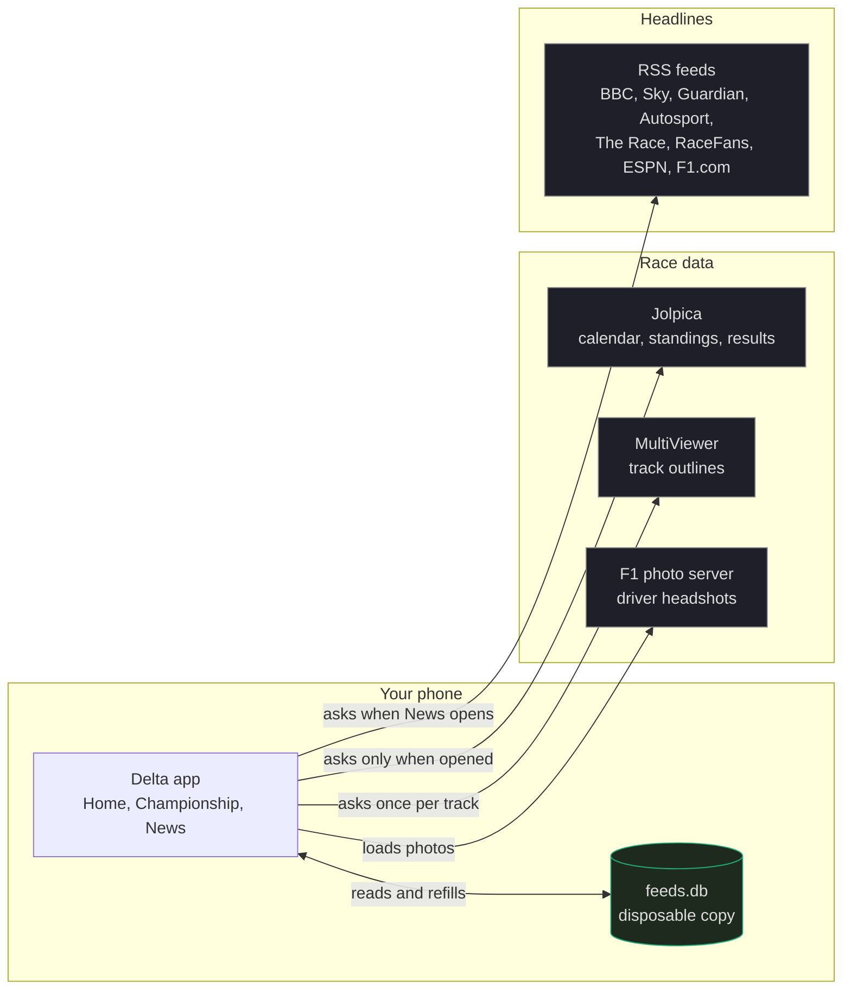

# Delta: architecture

An Android app (Kotlin, Compose) for Formula 1. Three tabs: Home, Championship, News.
Sideloaded, one user, no server of its own, no background work.

This replaces the three-tab design (Tasks, Valorant, F1). That design, including the Tasks
sync engine, is in git at tag `v1.1.2`. The map of the current code is `floorplan/index.html`
(regenerate it by asking for "update the floorplan").

## 1. The system in one picture

Everything the app shows is public data fetched on open. Nothing is created or owned by the
app, so `feeds.db` can be deleted at any moment and refills itself. That one fact removes the
sync, conflict and data-loss problems the old design spent most of its length on.

## 2. Stack

| Layer | Choice | Why |
|---|---|---|
| UI | Kotlin, Jetpack Compose, navigation-compose | Already in place |
| Cache | Room, one database (`feeds.db`), destructive migration | It is a cache, so a schema change just refetches |
| Network | Retrofit with kotlinx.serialization for Jolpica and MultiViewer, OkHttp for feeds | Already in place |
| Feed parsing | Android's built-in `XmlPullParser` | No new dependency for 8 simple feeds |
| Images | Coil | Already in place |
| Release | R8, signed from `keystore.properties`, `release.sh` publishes to GitHub | Already in place |

## 3. Sources, verified

Checked against the live services. Re-check before quoting any of this.

| Source | Cost | Limit | Use |
|---|---|---|---|
| Jolpica-F1 (`api.jolpi.ca/ergast/f1/`) | Free, no auth | 200 requests per hour | All results, 1950 onward. Load-bearing and volunteer-run, so cache as if it could vanish |
| MultiViewer (`api.multiviewer.app/api/v1/circuits/{key}/{year}`) | Free, no auth | none seen | Real track outlines and corners. 21 of the 23 circuits on the 2026 calendar return one |
| F1 CDN (`media.formula1.com`) | Free, no auth | none seen | Driver headshots. The path is not derivable from the driver id, so it is a pinned map |
| RSS feeds | Free | polite use | News, see `.scratch/f1-v2/spec.md` for the source set |
| OpenF1 | Free tier | 3 per second | **Locked entirely during live sessions**, past data included. Never put anything a user needs on race day behind it |
| F1 live timing (SignalR) | Free, no auth | stream | Foreground-only live feature, a later option |

Four facts that shaped the design:

1. OpenF1 goes dark during live sessions, so `teamColour()` and `headshotKey()` in `Repo.kt` are
   hardcoded maps, not fetches. Do not turn them into API calls.
2. Jolpica standings queries require a season. A driver's whole career cannot come from one call,
   so history is built from per-season standings fetched lazily and cached forever.
3. Jolpica caps `limit` at 100. Page with `offset`.
4. F1 publishes no 2026 car art. The constructor page uses its two drivers instead.

### Live timing, if it is ever built

Classic SignalR 1.5 at `livetiming.formula1.com`, three steps: `GET /signalr/negotiate` (keep the
cookie), open `wss://.../signalr/connect` with the connection token, then send a `Subscribe`.
Headers are case-sensitive (`User-Agent: BestHTTP`); wrong case returns 500. Sixteen streams;
those ending `.z` are zlib plus base64. It is undocumented and community reverse-engineered, so
it can break without notice and Jolpica stays the source of truth. It fits the no-background rule
because the socket lives only while the app is open during a session. Reference clients:
FastF1 and undercut-f1.

## 4. Cache policy

| Data | Refresh |
|---|---|
| Current season standings | Daily |
| Current season calendar | Weekly |
| Season results | Daily |
| Past seasons (standings, results) | Never, they are immutable |
| Track outlines | Never |
| Career totals | Weekly for active drivers, never for retired |
| News | 15 minutes, only when the tab opens |

**Rate limiting.** A token bucket (`RateLimiter.kt`) persists across process death, so a restart
cannot overspend Jolpica's 200 per hour. Normal use is a few dozen requests a week.

**Offline.** The target is that every screen renders from the cache with an "as of" time, and a
failed refresh keeps the old data and shows the reason. Today this is partial (feature X-04).
An endless spinner is the worst outcome.

## 5. Build order

| Phase | Deliverable | State |
|---|---|---|
| 0 | Scaffold, theme, Room, rate limiter | Done |
| 1 | Home, Standings, Driver, Constructor, Calendar, Weekend for Spa | Done (v1.1.2) |
| 2 | **V2**: three tabs, circuits for every track, Championship, race result and circuit pages, driver and team depth, News | Planned, see `.scratch/f1-v2/spec.md` |
| 3 | Qualifying, sprint, pit stops, lap chart | Later |
| 4 | OpenF1 enrichment (weather, stints, overtakes), Monday to Thursday only | Later |
| 5 | Live timing, race start reminders | Later |

## 6. Risks

| Risk | Severity | Response |
|---|---|---|
| Jolpica shuts down | High impact, possible | It is now load-bearing. Cache permanently, consider bundling a snapshot of past seasons |
| A news feed changes format or disappears | Likely over time | Each feed fails independently, the tab shows what loaded, parser tests run against saved samples |
| A publisher's RSS terms forbid this use | Unknown, terms not read | Sideloaded single-user app is the low-risk case. Read the terms before sharing the APK |
| MultiViewer drops a circuit or year | Low | Outline unavailable card, never a wrong drawing |
| Hardcoded season or pinned maps go stale | Certain each winter | Use Jolpica's `current` alias, review the pinned maps each pre-season |
| Scope creep | High | The feature map has a Later column. Hold the line |
