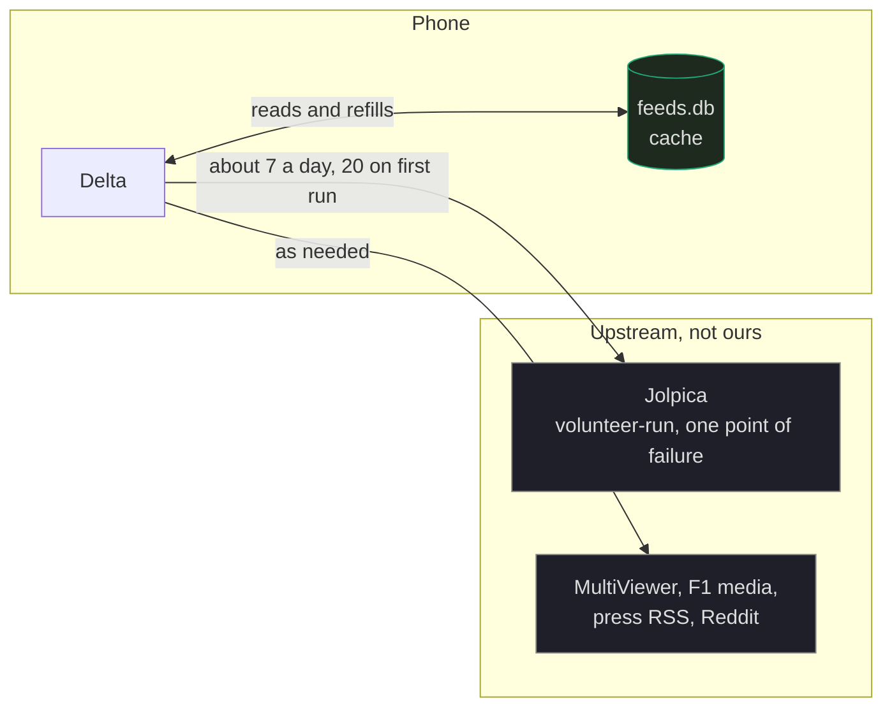
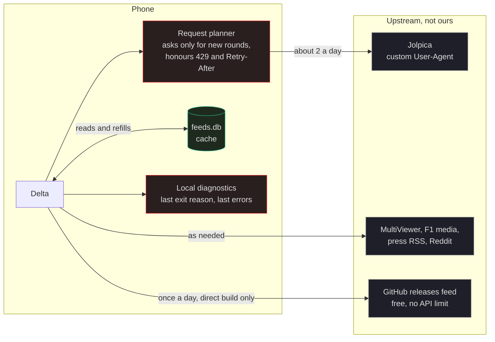

# Delta: redesign for a public audience at zero infrastructure cost

Status: phase 1 shipped in v1.4.0 (ADR-001 steps A and B, ADR-003, ADR-004, ADR-005 except the lazy News list, which was skipped because post-fix jank is acceptable). Phases 2 and 3 are not built. Method: the four-step process from the `system-design` skill, requirements, estimates and decision records from the `architecture-designer` skill. Every number below was measured on 2026-11-15 unless it says "estimate".

## 1. Summary

Delta was designed for one user. `docs/architecture.md` says normal use is "a few dozen requests a week". The app is now public, and the one thing that has not changed is the single upstream everything depends on: Jolpica, a volunteer-run API with a per-IP limit, a non-commercial data licence and no uptime promise.

The redesign stays client-only, with no server and no money. It does five things:

1. Cuts the requests the app sends to Jolpica by about 70% for a daily user, and stops breaking Jolpica's rules (no custom User-Agent today).
2. Shows the required data credit and licence, which the app does not do today.
3. Tells users when a fixed version exists, so a fix like the News freeze does not wait for a manual reinstall.
4. Makes failures diagnosable on the user's own phone, with no analytics.
5. Leaves one decision to the owner: whether to ship the immutable history inside the app, which the data licence makes a legal question and not a technical one.

## 2. Step 1: requirements and scope

| Kind | Requirement |
|---|---|
| Functional | Unchanged: standings back to 1950, driver and team pages, results, 3D circuits, news and Reddit, one reminder |
| Hard constraints | $0 infrastructure. No server of our own. No background execution. F1 only. No analytics or ads. One database, `feeds.db`, which is a disposable cache |
| Availability | The app must open and show something useful with no network and with Jolpica down. History must never need the network twice |
| Performance | No main-thread block over 100 ms on a mid-range phone. The News fix (v1.3.2) is the example of what happens when this is not a requirement |
| Compliance | Jolpica terms: custom User-Agent, respect the rate limit, credit the data under CC BY-NC-SA 4.0 |
| Operability | A maintainer can learn why it failed on a user's phone without a server or a stack trace from the user |

### Measured facts

| Fact | Value | How measured |
|---|---|---|
| Jolpica requests, one cold-start tour (Home, weekend, driver, team, race result, 1988 season, News) | 20 | Temporary request log in a debug build on an emulator, scripted tour |
| of which season results | 5 pages | Same log, `limit=100&offset=0..400` |
| Jolpica requests on a repeat day | about 7 | Calculated from the cache rules in `Repo.kt`: 2 standings, 5 results pages, calendar weekly |
| Rows in all of history | 26,313 results, 11,408 qualifying, 1,172 races, 77 seasons, 885 drivers, 214 teams, 78 circuits | `total` field of each Jolpica endpoint |
| Size of 1988 raw JSON | 13 KB standings, 4 KB teams, 45 KB results, gzip about 2, 0.7 and 4 KB | One request each, gzipped locally |
| Jolpica limits | Documented 4 per second burst and 500 per hour, "will decrease". The project's own check in November 2026 found 200 per hour. Design against 200 | `docs/rate_limits.md` in the Jolpica repo, `CLAUDE.md` |
| Who shares the limit | Everyone behind the same IP | Same document |
| Data licence | CC BY-NC-SA 4.0, non-commercial | `TERMS.md` in the Jolpica repo |
| User-Agent | Jolpica requires a custom one. Only the news feed client sets one. Jolpica calls go out as the OkHttp default | `Api.kt` line 72, no other `User-Agent` in `data/` |
| Hosting | Volunteer-run, about $45 a month, donation-supported, no uptime guarantee | Jolpica README and terms |

### Estimates (assumptions, not measurements)

| Assumption | Number |
|---|---|
| Daily users after a launch post | 300, with a bad case of 1,000 |
| Requests per user per day today | about 7, plus 20 once on first run |
| Fleet load today | 1,000 users is about 7,000 requests a day, 0.08 per second |
| Shared IP | Mobile carriers in India put many phones behind one address. If 100 users share one and open the app in the same hour, today they send about 700 requests against a limit of 200 to 500 |

The fleet load is small for Jolpica. The shared-IP case is the real exposure, because a throttled user sees an error and the app cannot tell them why.

## 3. Step 2: high-level design

Today, every screen that needs data asks Jolpica, including data that can never change.

Proposed, phase 1 (no licence change). The app asks only for what changed and says who it is:

Phase 2, if the owner approves it, adds a bundled history file so the 77 past seasons never touch the network. That is decision ADR-002.

## 4. Step 3: the three components that matter

### 4.1 The request planner (the data layer)

Where the requests go today:

| Cause | Requests | Why it is wasteful |
|---|---|---|
| Season results re-fetched daily as 5 pages | 5 a day | Rounds already fetched never change. A new race adds 22 rows |
| Driver career totals | 5 per driver, weekly | Five reads of `total` for numbers derivable from rows already fetched or bundled |
| Team career totals | 4 per team, weekly | Same |
| Circuit winners | 1 per circuit, weekly | History, immutable except for one new row a year |
| Standings, calendar | 3 | Needed, and already on daily and weekly timers |

The planner changes the first row in phase 1: store results by round, fetch the full season once, then ask only for rounds that are finished and not stored. A repeat day drops from about 7 requests to about 2. It also reads `Retry-After` on a 429, backs off, and tells the user "the data service is busy, showing saved data" instead of a generic failure. Jolpica's own guide asks for exactly these: cache, and fewer, larger queries.

### 4.2 The upstream dependency

Jolpica is the single point of failure, the licence is non-commercial, and its limits "will decrease". `docs/architecture.md` already listed "bundle a snapshot of past seasons" as the response to the shutdown risk. The options are in ADR-002. Whatever is chosen, the current season stays live, because it changes every race weekend.

### 4.3 Release, update and diagnosis

A sideloaded app has no update path and no crash reporter. The News freeze needed a debugging session and a manual reinstall. Two zero-cost additions fix that without breaking the no-analytics promise: a once-a-day check of the GitHub releases feed (ADR-004) and a local diagnostics screen (ADR-005).

## 5. Decisions

### ADR-001: Plan requests, do not just cache them

Status: proposed. No licence impact.

Context: about 7 Jolpica requests per user per day, mostly re-reading immutable rows. Limits are shared by IP and will decrease.

| Option | Cost | Effect |
|---|---|---|
| A. Keep as is | none | Every new user adds load, shared-IP users get errors with no explanation |
| B. Incremental results, 429 handling, custom User-Agent | about a day | About 7 to about 2 a day, compliant, honest error messages |
| C. B plus bundled history | B plus ADR-002 | Cold start 20 to about 3 |

Decision: B now. C is ADR-002.

Consequences: the results table needs a per-round key. The User-Agent line is a compliance fix and could ship alone.

### ADR-002: Ship the immutable history inside the app?

Status: needs the owner. This is a legal decision first.

Context: 77 past seasons never change. Shipping them removes most of the remaining requests, makes history work offline and survives a Jolpica outage. Estimated size, from the row counts: about 0.3 MB compressed in a compact format, against a 2.6 MB APK. Jolpica offers database dumps, free for non-commercial use, available 14 days after upload, which avoids scraping the API for it.

The catch is the licence. The data is CC BY-NC-SA 4.0:

- It must be credited with a link to the licence and a note that it was modified.
- ShareAlike means a bundled copy stays under the same licence. The code stays AGPL-3.0, so the file needs its own licence notice and a clear boundary.
- Non-commercial, and Delta has a Buy Me a Coffee link and has considered Google Play. Donations may or may not count as commercial. That is for a lawyer or for Jolpica to say, and this document does not settle it.

| Option | Cost | Effect |
|---|---|---|
| A. Do not bundle | none | No licence change. History keeps costing requests, outage risk stays |
| B. Bundle, after asking Jolpica's maintainers | an email and about 3 days | Biggest request cut, offline history, covers the shutdown risk. Needs their reply on donations and redistribution |
| C. Public static mirror on GitHub Pages | free, a scheduled job, ongoing upkeep | Fewer requests to Jolpica for every user, but it republishes the data, breaks "no server of our own" and adds a thing to maintain |

Decision: ask the maintainers (draft in section 8), do A until they answer, and do B if they agree. Do not do C unless Jolpica starts throttling real users.

### ADR-003: Comply with the data terms

Status: proposed. Small and unconditional.

Add a `User-Agent` of the form `Delta/<version> (+<repo url>)` to every request, not just the feeds. Add a "Data and licences" screen (the footer line today is not enough) crediting Jolpica with the CC BY-NC-SA 4.0 link, MultiViewer, and the F1 images, with the existing unofficial notice. Cost: under an hour. Risk if skipped: being blocked without warning, which the terms allow.

### ADR-004: Tell users when a new version exists

Status: proposed, `direct` build only.

| Option | Cost | Effect |
|---|---|---|
| A. Nothing | none | Fixes reach users only if they come back to the repo |
| B. Read the GitHub releases Atom feed once a day when the app opens, show a quiet banner that opens the release page in the browser | about half a day | No new permission, no background work, outside the REST API limit, and the `play` build has none of it |
| C. Download and install the APK inside the app | more code | Needs the install-packages permission, which widens the attack surface the security policy avoids |

Decision: B. It uses the same https-only link rule as the support link.

### ADR-005: Diagnose locally, report nothing

Status: proposed.

The hardest part of the News bug was that no trace existed. Android 11 and later keep a record of why the last process ended (crash, not responding, low memory, native crash). The app can read that on the next launch and show "Copy diagnostics" on the data screen: version, Android version, last exit reason, last refresh time and error per source. The user pastes it into an issue. Nothing is sent anywhere.

| Option | Effect |
|---|---|
| A. Nothing | Next bug, same blind debugging |
| B. Local record and a copy button | Free, keeps "no analytics" true |
| C. A crash-reporting SDK | Breaks the promise and adds a third-party SDK |

Decision: B. Pair it with StrictMode in debug builds, so main-thread work is caught before release, and a lazy list for the News wire, which still draws every story at once.

## 6. Scorecard

The `system-design` rubric has eight rows written for server systems. Rows that do not apply to a client app are marked.

| Check | Today | After phase 1 |
|---|---|---|
| Requirements listed | No, `architecture.md` assumes one user | Yes, section 2 |
| Estimates | No | Yes, with the assumptions marked |
| Redundant components | No, one upstream | No, still one upstream |
| Data scaling strategy | Not applicable, client cache | Not applicable |
| Cache on read-heavy paths | Yes | Yes, plus incremental fetch |
| Async paths use queues | Not applicable | Not applicable |
| Monitoring plan | No, by design | Yes, local diagnostics |
| Deployment plan | Manual release, no update path | Release notes plus update banner |

Today 3 of 8, which rounds to 4 out of 10. After phase 1, 7 of 8, 9 out of 10. The missing point is a second source for current-season data. Doing that means a mirror, which costs the no-server rule, so I recommend living with it.

## 7. What costs money

Nothing in this plan. GitHub, its releases feed and any scheduled job on a public repository are free, and no new service, account or SDK is added. The only optional spend is a donation to Jolpica, which hosts the service for about $45 a month and receives the traffic this app sends.

| Phase | Work | Needs a decision |
|---|---|---|
| 1 | ADR-001 (option B), 003, 004, 005. Release as 1.4.0 | Approval of this document |
| 2 | ADR-002 option B | A reply from the Jolpica maintainers |
| 3 | A mirror | Only if real users are throttled |

## 8. Draft message to the Jolpica maintainers

Post it in the repository's GitHub Discussions.

> Hi, I maintain Delta, a free, open-source (AGPL-3.0) Android F1 tracker that reads from your API. We cache everything, send a custom User-Agent, and are moving to fetch only new rounds. Two questions. First, would shipping a snapshot of past seasons inside the app (credited, with the CC BY-NC-SA 4.0 notice, rebuilt from your database dumps once a year) be acceptable? Second, the app has an optional donation link for the developer. Do you consider that non-commercial use? Thank you for running this.
